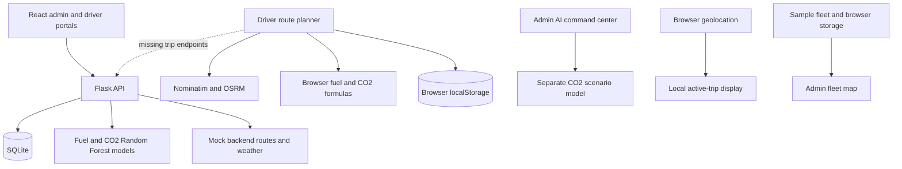

> Historical reference from the original upload. For this updated build, use [SETUP_EXPO.md](SETUP_EXPO.md); old demo startup instructions no longer apply.

# GoGreen: project audit and improvement plan

> **Update, 23 Oct 2026:** the synthetic Random Forest has been replaced by a physics road-load model with live weather, terrain and per-vehicle calibration. See `docs/MODEL.md`. Sections below that describe the synthetic model or display-only weather are historical.

**Reviewed:** 23 October 2026  
**Scope:** Current working copy, including existing uncommitted changes. Source inspection, frontend build, scoped lint, and Python syntax checks. No application logic was changed during this audit.

## 1. Executive assessment

GoGreen is a web application intended to help fleet administrators manage drivers and vehicles while helping drivers choose routes with lower predicted fuel consumption and carbon emissions. It combines a React interface, Flask API, SQLite database, mapping services, and Random Forest regression models.

The project has a useful major-project foundation: two user roles, driver approval, vehicle management, map-based route planning, model training code, and export endpoints. However, it currently behaves as several partially connected prototypes. The driver trip experience can appear successful while no trip is recorded in the backend. Several prominent analytics and tracking displays use fixed or simulated values.

**Assessment: a substantial prototype that needs integration and evidence work before it can credibly demonstrate end-to-end eco-friendly fleet management.** The highest-value next step is to complete one reliable journey from approved driver to saved trip, tracked journey, completed record, and administrator report.

This is an engineering assessment, not a numerical quality score. Backend runtime behavior and visual usability have not been verified in this environment.

## 2. What the project actually does

### Intended user journey

1. A driver requests an OTP and submits a registration.
2. An administrator approves the driver and assigns a vehicle.
3. The driver enters a source, destination, and cargo weight.
4. The system presents route alternatives with distance, duration, fuel, CO2, and an eco score.
5. The driver selects a route, starts a trip, and views their location.
6. The completed trip should become part of driver history and fleet analytics.
7. The administrator monitors the fleet and exports sustainability reports.

### Current implementation

| Area | What exists | Qualification |
|---|---|---|
| Authentication | bcrypt password hashes, JWT access/refresh tokens, frontend route guards, server admin-role decorator | OTP delivery is a demo; deployment defaults and validation need work |
| Driver administration | Registration, approval/rejection, profile API, notification creation, audit records | Profile and notification pages are placeholders; notification reads have a schema mismatch |
| Vehicle administration | List, create, edit, delete, assign a driver | Assignment, capacity, status, and historical-data invariants need stronger validation |
| Driver route planning | Browser calls to Nominatim and OSRM; Leaflet road geometry; city-name lookup | External calls were not exercised; fuel and eco scores are frontend heuristics, not backend ML predictions |
| Backend trip planning | Trip and candidate-route persistence; fuel/CO2 predictor calls | Mapping service generates random mock routes without a key and returns no routes when a key is present |
| Active trip screen | Browser geolocation watch and distance-to-destination display | Location stays in the browser; no GPS upload from the current screen |
| Driver history | Browser-local completed-trip history fallback | Requested backend history endpoint does not exist |
| Live fleet map | Map interface with sample drivers and a local active-trip entry | No shared server telemetry feed; positions and speeds are simulated |
| AI command center | Separate Random Forest CO2 scenario comparison | Assumes traffic factors and a 4% longer eco route; does not optimize an actual road network |
| Driver eco coach | Interactive penalties for braking, acceleration, idling, and speed | Rule-based calculation from manually controlled inputs; no learned driver model or measured telemetry |
| Sustainability dashboard | Database-backed summary endpoint plus charts and rankings | Savings use an assumed 20% factor; trend, chart values, and ranking are fixed samples |
| Reports | Excel generator and basic PDF generator | UI authorization is broken; PDF contains only a heading, completed-trip count, and thank-you text |
| Settings and recovery | Settings UI and backup/restore endpoints | Settings are process-local and not applied to workflows; backup/restore only return messages |

### Technology and architecture

- **Frontend:** React 19, Vite 8, React Router, Axios, Tailwind CSS, Leaflet, and Lucide icons, as declared in the local package manifest.
- **Backend:** Flask, SQLAlchemy, Flask-Migrate, Flask-JWT-Extended, Flask-Limiter, bcrypt, pandas, and scikit-learn.
- **Storage:** SQLite by default; database URI is configurable.
- **Models:** Two predictors under `backend/app/ml/models` and a separate CO2 predictor under `backend/app/ai_models`.
- **Outputs:** Excel through pandas/openpyxl and PDF through ReportLab.

The following diagram describes current code paths, not a verified live deployment:

### Database design

The model layer contains User, Driver, Vehicle, Trip, Route, TripLog, Notification, FuelLog, WeatherLog, Emission, MaintenanceLog, Setting, MLModel, and AuditLog. A driver belongs to a user; a vehicle can be assigned to a driver; a trip links a driver and vehicle; route alternatives and GPS log records belong to a trip.

The schema is broader than the implemented workflows. For example, TripLog exists but the GPS endpoint does not insert it; Setting exists but settings endpoints use a dictionary. Trip has start/end timestamp columns but its lifecycle handlers do not populate them. No migration directory was found in the reviewed project files.

## 3. Priority findings

P0 means a core integrity/security issue to resolve before shared use. P1 means a major correctness or demonstration blocker. P2 means maintainability, operability, or completeness work. These are project-specific priorities, not external vulnerability ratings.

### P0 — Trip endpoints lack ownership checks

**Evidence:** `backend/app/blueprints/trips/routes.py:105` onward. Get, select-route, start, end, and log endpoints require a JWT but do not verify that the trip belongs to the requesting driver or that an administrator has the relevant permission.

**Impact:** A logged-in user who knows another trip ID can read or modify that trip through these handlers. Login alone does not establish authorization for a particular record.

**Change:** Centralize trip access rules. Require the assigned, approved driver for driver mutations; explicitly define admin read privileges. Test two different drivers and an administrator against the same trip.

### P0 — Frontend trip lifecycle does not match the API

**Evidence:** `frontend/src/pages/driver/NewTrip.jsx:217`, `:250`; `ActiveTrip.jsx:111`; `TripHistory.jsx:11`; `backend/app/blueprints/trips/routes.py`.

| Frontend request | Actual backend contract |
|---|---|
| `POST /api/v1/trips/plan` | `POST /api/v1/trips` |
| `POST /api/v1/trips/start` | `POST /api/v1/trips/<int:trip_id>/start` |
| `POST /api/v1/trips/<id>/complete` | `POST /api/v1/trips/<int:trip_id>/end` |
| `GET /api/v1/trips/history` | No history endpoint |

The frontend creates IDs such as `trip-<timestamp>` while the API expects integer database IDs. Payloads also differ: frontend `origin`/`loadWeight` and camelCase route fields do not match backend `source`/`load_weight_kg` and snake_case responses. `App.jsx` declares `active-trip/:id`, while `ActiveTrip.jsx` reads `tripId`.

**Impact:** Start and completion handlers still save browser state in `finally`, even after failed API calls. An interface success therefore does not prove a persisted fleet trip. History is tied to one browser and its generic keys can survive account changes.

**Change:** Define one API contract, use server-issued IDs, adapt response fields deliberately, and show success only after persistence succeeds. Implement authenticated history. Any offline mode must show an explicit unsynced state and separate records by user.

### P1 — Route selection and trip state are not preserved correctly

**Evidence:** `backend/app/blueprints/trips/routes.py:131–188`; `backend/app/models/trip.py`.

The select handler reads `route_id` but neither verifies nor stores it. Completion takes `trip.routes[0]` for scoring. Creation immediately sets `in_progress`; start/end do not set their timestamps or enforce valid transitions. Completion can be repeated, and actual fuel/CO2 default to zero.

**Change:** Persist the chosen route, validate that it belongs to the trip, introduce planned/in-progress/completed/cancelled states, record UTC timestamps, and make repeat completion safe. Keep missing actual measurements distinct from zero. Enforce vehicle availability, cargo capacity, and one active trip per driver/vehicle as appropriate.

### P1 — Tracking is local and GPS logging is a no-op

**Evidence:** `ActiveTrip.jsx:53–89`; `backend/app/blueprints/trips/routes.py:192`; `LiveFleetMap.jsx:20–125`.

The driver watches device location but does not send it to the backend. The backend reads coordinates but never persists a TripLog. Deviation is accepted from a client boolean rather than computed from stored route geometry. The fleet page starts from sample vehicles and invents a midpoint position for a browser-local trip.

**Change:** Store the selected route geometry and validated timestamped GPS points, expose latest authorized positions, and poll initially. Display last-seen time, location accuracy, and stale/offline status. Compute deviation against route geometry with a tolerance and notification deduplication. Use route progress rather than comparing straight-line remaining distance to road-route length.

### P1 — Notifications conflict with the database model

**Evidence:** `backend/app/models/route_logs.py` defines Notification without `title`; `backend/app/blueprints/notifications/routes.py:18` reads `n.title`; trip deviation constructs notifications with `title=` at lines 215 and 226.

**Impact:** A nonempty notification list will access a nonexistent attribute, and deviation notification construction uses an invalid model keyword. An empty list can conceal the read defect.

**Change:** Decide whether titles are part of the schema; add a migration if so, or remove title use consistently. Test actual populated notifications, approval notifications, and deviation alerts.

### P1 — Report download sends an undefined token

**Evidence:** `frontend/src/pages/admin/Reports.jsx:8–13`; `frontend/src/context/AuthContext.jsx`.

Reports destructures `token` from a context that exposes only user, login, logout, loading, and fetchUser. The fetch therefore sends `Bearer undefined`. It also bypasses the configurable Axios client and refresh behavior.

**Change:** Download blobs through the shared authenticated API client. Verify both exports with a valid admin session, expired access token, empty dataset, and populated dataset. Expand the PDF to match its advertised content.

### P1 — Model predictions and displayed recommendations are disconnected

**Evidence:** `NewTrip.jsx:120–169`; `backend/app/ml/predict.py`; `backend/app/blueprints/ai/__init__.py`; `backend/scripts/train_model.py`.

The normal driver planner assigns scores 84, 97, and 88 by route index, yet always marks the first route as AI recommended. Fuel efficiency and traffic delays are assumed; assigned vehicle type is not used. The backend instead ranks by emissions per kilometre, which does not necessarily minimize total journey emissions. The separate command-center model compares assumed scenarios, not road routes.

**Change:** Use one prediction service on actual candidate-route features, specify the optimization objective, and return the recommendation and explanation from the server. Prefer total predicted CO2 subject to an explicit travel-time constraint for the initial version. Label heuristic estimates and scenario simulations accurately.

### P1 — Sustainability claims are not derived from measured savings

**Evidence:** `backend/app/blueprints/admin/routes.py`, `backend/app/blueprints/reports/routes.py`, and `frontend/src/pages/admin/Sustainability.jsx`.

Backend savings are `actual_co2_kg * 0.2`, independent of the chosen alternative. The dashboard's average score, reduction percentage, monthly bars, and top drivers are hardcoded. The current planner uses 2.31 kg/L, while the backend synthetic pipeline uses 2.68 kg/L; their assumptions are not reconciled.

**Change:** Persist a comparable baseline and selected-route prediction. Report estimated avoided emissions as their difference under the same model, vehicle, units, and assumptions. Keep measured outcomes separate. Define fuel-specific factors and the scope of EV emissions. Replace sample charts with date-filtered database aggregation and honest empty states.

### P1 — Backend providers and environment setup are incomplete

**Evidence:** `backend/app/services/google_maps_service.py`, `weather_service.py`, and `backend/run.py:5`.

Setting a Google Maps key currently switches from random mock alternatives to an empty list; actual integration is TODO. Weather uses random samples without a key and a fixed clear result with one. The dotenv path appends `backend/.env` to an already-backend directory, targeting `backend/backend/.env` rather than `backend/.env`.

**Change:** Use explicit provider adapters and a clearly marked demo configuration. Handle no-route/provider-failure cases before committing a trip. Correct dotenv loading and add nonsecret example configuration plus database initialization instructions.

### P1 — Authentication and deployment defaults need tightening

**Evidence:** `backend/app/blueprints/auth/routes.py`, `backend/app/__init__.py:20–21`, and `backend/run.py:14`.

OTP values are stored without expiry in process memory and generated with `random`; the default development mode returns them to the requester. Production claims delivery without sending email. Known fallback signing keys and unconditional debug mode are unsuitable for shared deployment. Driver approval is checked during login, but existing tokens are not checked against approval in trip mutation handlers. AI endpoints lack authentication and numeric input validation.

**Change:** Make demo mode explicit, use expiring secure OTPs and a real delivery integration when needed, enforce attempts and validation, require deployment secrets, and gate debug mode. Reject invalid/negative/nonfinite inputs and recheck current authorization on sensitive operations. Add tests for approval changes after login.

### P2 — Duplicate AI implementations and an obsolete test contract

There is both `backend/app/blueprints/ai.py` and an `ai/` package. The app imports the package blueprint with `/api/ai`, while `ai/routes.py` defines legacy fleet-health endpoints and duplicates the `get_insights` route/function. The test requests `/api/v1/ai/fleet-health`, which the current application does not register. A training script is also duplicated under `frontend/src/pages/public/train_model.py`.

**Change:** Consolidate active AI code and training entry points. Align route registration, frontend requests, and tests. Do not simply enable the legacy blueprint without resolving its duplicate endpoint definitions.

### P2 — Settings, backup, and restore overstate implemented behavior

Settings live in a module dictionary despite a Setting table. Updating strict routing, auto-approval, or retraining interval does not connect those values to the relevant workflows. Backup and restore endpoints return fixed success/pending messages without performing recovery work.

**Change:** Persist and apply settings. Clearly mark recovery actions unavailable until actual backup, validation, and restore logic exists. A successful HTTP response must not be the only backup test.

### P2 — Reproducibility and test coverage are weak

Both bundled virtual environments reference other machines. The README omits database initialization, model setup, demo limitations, and much of backend configuration. Ignore files are deleted in the existing working copy; generated caches are tracked and dependencies appear as untracked content. The lint script scans third-party dependencies. There are ten backend test functions, including an ML test that only asserts `True` and trip tests limited to missing records. No frontend test script is declared.

**Change:** Build a fresh reproducible environment, restore appropriate ignore rules without overwriting unrelated work, add migrations and a documented demo seed process, scope lint, and add workflow tests. Preserve user data and review tracked artifacts before any cleanup.

## 4. Machine-learning credibility for a major project

There are real Random Forest training scripts and serialized model artifacts. That is distinct from demonstrating real-world accuracy or proving routing benefits.

- `backend/app/ml/train_models.py` trains fuel and CO2 models from generated synthetic data using an 80/20 split and records MAE and R2 in the database. The generator constructs targets from distance, load, traffic, weather, and vehicle categories with noise.
- `backend/scripts/train_model.py` trains a separate CO2 model on 2,000 synthetic samples, fits all samples, and does not calculate held-out evaluation metrics.
- The CSV named `Carbon_Footprint_Dataset_1560.csv` is present, but no reference to it was found in the reviewed training/application code. Do not describe it as the training source without establishing that link.
- The two pipelines have different vehicle encodings, feature sets, and EV assumptions. Current model accuracy was not measured in this audit.
- The AI command-center text mentions elevation, but elevation is not a model input in the reviewed prediction path.

For a defensible evaluation, consolidate the pipeline, document dataset provenance and units, compare a simple formula baseline against the learned model, and report held-out MAE/RMSE/R2 with per-vehicle errors. Keep a final test set separate from tuning. If real trips become available, split by journey/vehicle or time to reduce leakage. Record model version, feature schema, training data version, and prediction mode with each result.

For route evaluation, compare alternatives for the same origin, destination, vehicle, and load. Report predicted total CO2, time cost, and fuel cost. Synthetic-test performance supports a simulation claim; it does not establish measured fleet emissions reductions.

## 5. Recommended improvement sequence

| Phase | Work | Completion evidence |
|---|---|---|
| 1: Reliable core | Align API contracts; persist selected routes; fix ownership, notifications, report authentication, timestamps, and validation; establish a clean backend environment | Two drivers cannot access each other's trips; a trip survives logout/reload and appears in admin records; exports open correctly |
| 2: Connected tracking and estimates | Store route geometry; send GPS to backend; provide fleet positions and history; connect one predictor; remove hidden fake-success paths | Separate driver/admin sessions see the same trip and fresh location; predictions and recommendations are reproducible and show their source |
| 3: Defensible analytics | Compute baseline comparisons; replace fixed charts; evaluate model against baseline; persist settings; implement meaningful tests and migrations | Dashboard and exports reconcile with trip data; model metrics are reproducible; empty and failure states are tested |
| 4: Submission polish | Consistent naming/theme; mobile checks; loading/error/permission states; complete profile and notifications; improve PDF; document deployment and limitations | A rehearsed demonstration and report accurately match implemented behavior |

The first implementation milestone should be **one approved driver with one assigned vehicle completing a database-backed trip that an administrator can inspect and export**. This is more valuable at this stage than adding another AI screen.

After the core works, useful differentiators would be explainable route tradeoffs, predicted-versus-actual analysis, route replay, and vehicle-specific energy modeling. Each should use stored data and have a measurable acceptance criterion. UI refinements worth checking include the dark New Trip panel with dark heading text, consistent GoGreen/EcoRoute branding, GPS-denied behavior, and errors currently sent only to the console. These are source-level observations; a visual accessibility audit remains outstanding.

## 6. Validation performed and limits

| Check | Result |
|---|---|
| Frontend `npm.cmd run build` | Passed; Vite reported a 534.88 kB minified main JavaScript chunk and a chunk-size warning |
| Default `npm.cmd run lint` | Exited 1 after scanning dependencies; third-party output is not a useful source-code quality result |
| Scoped `oxlint src vite.config.js tailwind.config.js postcss.config.js --format=stylish` | Passed with 0 errors and 16 warnings, including unused symbols and hook dependencies |
| Python AST parsing | 45 backend application, script, test, and entry-point files parsed with no syntax errors |
| Backend pytest through bundled venv | Could not start: its interpreter path references another Windows account |
| Backend pytest through installed Python | Could not start: installed Python 3.14 has no pytest module |
| Source contract and model inspection | Completed for main frontend pages, API client/auth context, backend routes, models, providers, training scripts, and tests |

No backend tests are claimed as passed. Syntax parsing does not validate imports, serialized-model compatibility, database behavior, or request handling. No browser walkthrough, live mapping request, mobile-device GPS test, load test, dependency vulnerability scan, or fresh model evaluation was performed. Security findings are grounded in source inspection rather than live exploitation.

The working copy already contained many modifications before this audit. This audit added this report and generated frontend build output; it did not change application behavior, reseed the database, retrain models, or remove existing files.

## 7. Major-project presentation and demonstration

**Suggested project description:** “GoGreen is a fleet-management and eco-routing prototype that combines driver approval, vehicle assignment, map-based route alternatives, fuel and emissions estimation, and administrator reporting. Its next milestone is a unified, persisted trip workflow with transparent prediction assumptions and shared GPS tracking.”

For the final submission, prepare a problem statement, scope, use-case diagram, architecture diagram, ER diagram, API contract, algorithm description, dataset/model evaluation, workflow test evidence, screenshots, installation guide, limitations, and future work. Clearly distinguish implemented, simulated, and proposed capabilities.

A strong demonstration after the core fixes would show:

1. Register a driver, approve the account, and assign a vehicle.
2. Plan a journey and explain why a particular alternative is recommended.
3. Start it, refresh the page, and prove the trip remains saved.
4. Show location updates in a separate administrator session, including stale-location handling.
5. Complete it once and verify consistent history, timestamps, and aggregates.
6. Download matching Excel/PDF reports.
7. Demonstrate denial of another driver's trip access and graceful handling of a routing-provider failure.

The project will be stronger when each displayed claim can be traced to an API response, a persisted record, and a test or reproducible calculation.
